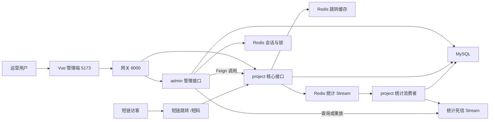
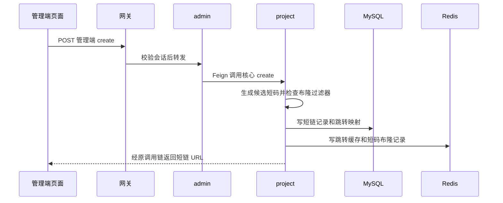
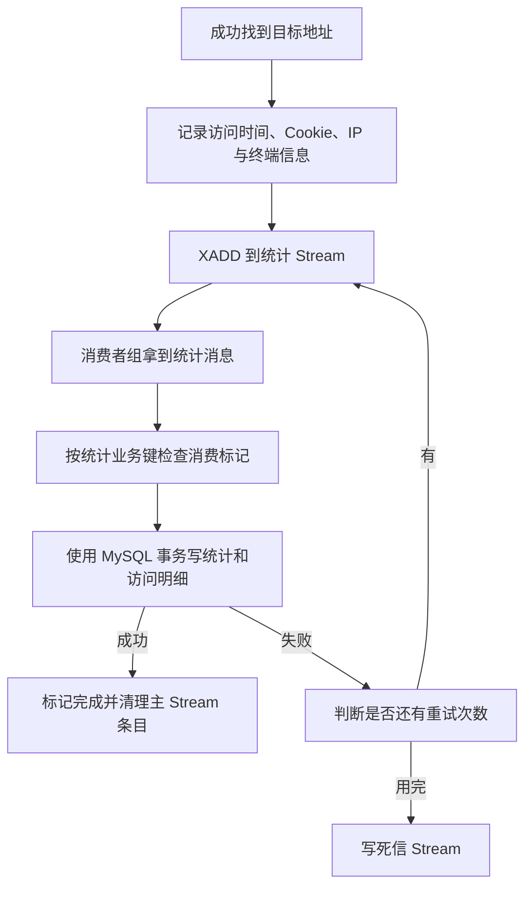

# LinkFlow 项目解析

这份文档以本地 `main` 的修复提交 `336a4c2` 为准。先用一条短链看懂系统，再按入口追到代码和数据。本地 `main` 已补齐前端入口、后端工具类和依赖锁文件，可以从它新建干净工作树按步骤运行。 [Windows 本地部署与验收](linkflow-local-deployment.md)

## 一、先看项目怎样运转

假设你登录后台，把长地址 `http://127.0.0.1:5173/` 保存到「默认分组」，收到短链 `http://127.0.0.1:8003/<短码>`。之后会发生三件事：

1. 你在管理端创建短链。请求经过网关，后端把长地址、短码、分组和有效期存入 MySQL，并把跳转映射放入 Redis。
2. 访客访问短链。短链服务找到目标地址，采集一次访问，向 Redis Stream 投递消息，再返回 HTTP 302。浏览器按响应的 `Location` 打开目标页面。
3. 后台消费者读到消息，更新统计和访问明细。你刷新统计面板，管理端查询的是 MySQL 已经保存的数据。消息还在排队时，面板可能暂时看不到刚才那次访问。

图里的 `admin` 和 `project` 是代码模块。**聚合运行时，两个模块在同一个 `aggregation` 进程里监听 `8003`。** 管理接口调用核心接口仍走 Feign，目标地址由 `aggregation.remote-url` 指向本机聚合进程。**拆分配置中，`admin` 监听 `8002`，`project` 监听 `8001`。** 两种方式的管理端都访问网关，短链则直接访问承担跳转的业务服务。

| 常见术语 | 在 LinkFlow 中是什么 |
| --- | --- |
| 请求、响应 | 浏览器向服务提交数据，服务返回 JSON 或 302 等结果 |
| 网关 | 根据 URL 路径选服务，并对需要登录的管理请求检查 Token |
| Controller、Service、Mapper | Controller 接 HTTP 请求，Service 完成业务步骤，Mapper 执行数据库读写 |
| DTO、DO | DTO 在接口或消息中传数据，DO 对应数据库记录 |
| Feign | Java 接口声明远程 HTTP 请求，管理服务用它调用核心接口 |
| ShardingSphere | 应用写逻辑表名，它依据分片键决定实际访问哪张物理表 |
| Redis Stream 与消费者组 | Stream 保存待处理消息，消费者组负责拉取和分配这些消息 |
| 幂等 | 同一件事重复处理时，尽量避免把该做一次的写入变成多次 |

## 二、按模块认识代码

| 模块 | 主要职责 | 从哪儿看 |
| --- | --- | --- |
| `console-vue` | Vue 页面、表单、短链列表、图表、二维码和统计死信页面 | [路由](../console-vue/src/router/index.js)、[Axios 请求配置](../console-vue/src/api/axios.js)、[我的空间](../console-vue/src/views/mySpace/MySpaceIndex.vue) |
| `gateway` | 路由、会话检查，把请求交给管理服务或核心服务 | [Token 过滤器](../gateway/src/main/java/com/nageoffer/shortlink/gateway/filter/TokenValidateGatewayFilterFactory.java)、[聚合路由](../gateway/src/main/resources/application-aggregation.yaml)、[拆分路由](../gateway/src/main/resources/application-dev.yaml) |
| `admin` | 用户和分组管理，封装后台接口，代理建链、回收站和统计请求，提供死信操作 | [用户服务](../admin/src/main/java/com/nageoffer/shortlink/admin/service/impl/UserServiceImpl.java)、[分组服务](../admin/src/main/java/com/nageoffer/shortlink/admin/service/impl/GroupServiceImpl.java)、[Feign 接口](../admin/src/main/java/com/nageoffer/shortlink/admin/remote/ShortLinkActualRemoteService.java) |
| `project` | 短码生成、跳转、回收站、统计消费与查询 | [短链服务](../project/src/main/java/com/nageoffer/shortlink/project/service/impl/ShortLinkServiceImpl.java)、[统计消费者](../project/src/main/java/com/nageoffer/shortlink/project/mq/consumer/ShortLinkStatsSaveConsumer.java) |
| `aggregation` | 一个 Spring Boot 进程加载管理、核心和聚合模块 | [聚合启动类](../aggregation/src/main/java/com/nageoffer/shortlink/aggregation/AggregationServiceApplication.java)、[启动配置](../aggregation/src/main/resources/application.yaml) |
| `resources/database` | 创建物理表的 SQL | [建表脚本](../resources/database/link.sql)、[数据库说明](../resources/database/README.md) |
| `format` 和根 `pom.xml` | 格式配置、Maven 多模块依赖和编译配置 | [格式说明](../format/README.md)、[根 POM](../pom.xml) |

### 先记住这几张表

聚合配置使用一个 MySQL 数据源 `ds_0`。用户、分组、短链、跳转映射分别有 16 张物理表。下面的 `_0 … _15` 表示表名末尾的数字。按分片键执行等值查询时，ShardingSphere 能计算目标表；排查时可查看它打印的实际 SQL。 [ShardingSphere 配置](../aggregation/src/main/resources/shardingsphere-config-dev.yaml)

| 逻辑表 | 分片键 | 放什么 |
| --- | --- | --- |
| `t_user` | `username` | 账号、资料和删除标记。电话和邮箱字段配置了 AES 加密 |
| `t_group` | `username` | 用户所属分组、分组 ID `gid`、名称和排序 |
| `t_group_unique` | 单表 | 为 `gid` 提供全局唯一记录 |
| `t_link` | `gid` | 长地址、完整短链标识、启用状态、有效期和总 PV、UV、UIP |
| `t_link_goto` | `full_short_url` | 由完整短链标识找到 `gid`，再到 `t_link` 查目标地址 |
| `t_link_access_stats`、`t_link_stats_today` | 单表 | 访问聚合和按日统计 |
| `t_link_access_logs` | 单表 | 每次已写库访问的明细，包括访客、来源、设备和原访问时间 |
| `t_link_browser_stats` 等维度表 | 单表 | 地区、浏览器、操作系统、设备和网络的聚合数据 |

为什么建一条短链要有两条业务记录？你在「我的空间」里从分组找短链，手里已经有 `gid`。访客点进来时手里只有短地址，`t_link_goto` 把它转换成 `gid`，避免从 16 张短链表逐张找。示例中的数据库标识是 `127.0.0.1:8003/<短码>`，完整的浏览器 URL 则带 `http://`。

### 再记住 Redis 中几类数据

| 数据 | 结构 | 用途 |
| --- | --- | --- |
| `short-link:login:<用户名>` | Hash | Token 到登录用户信息的映射，登录时设置 30 分钟有效期 |
| `short-link:goto:<完整短链标识>` | 字符串 | 正向跳转缓存，值是长地址 |
| `short-link:is-null:goto_<完整短链标识>` | 字符串 | 已查过且不能跳转的记录，短时拦住重复查表 |
| 短码、用户名和分组 ID 的布隆过滤器 | 位集合 | 快速判断一个值是否可能存在，最终唯一性以数据库约束为准 |
| `short-link:stats:uv:<完整短链标识>` 和 `short-link:stats:uip:<完整短链标识>` | Set | 按短链记录访问过的访客标识和 IP，`SADD` 新增成员时产生首次标记 |
| `short-link:stats-stream` | Stream | 等待统计消费者处理的访问消息 |
| `short-link:stats-stream:dead-letter` | Stream | 超过重试上限的访问消息，由运维查询和重放 |
| `short-link:idempotent:<业务键>` | 带过期的字符串 | 标记统计事件正在处理或已完成，有效期为 2 分钟 |

[Redis 键常量](../project/src/main/java/com/nageoffer/shortlink/project/common/constant/RedisKeyConstant.java) · [消费幂等处理器](../project/src/main/java/com/nageoffer/shortlink/project/mq/idempotent/MessageQueueIdempotentHandler.java)

## 三、按事件追踪业务落地

下面按「谁触发、代码怎么走、最后写在哪里」拆解主要流程。管理端 API 都经 `/api/short-link/admin/v1`，核心 API 经 `/api/short-link/v1`。

### 1. 注册、登录、修改资料与退出

1. 点击注册，前端提交用户名、密码和资料到 `POST /user`。注册和登录是网关放行的入口。后端先通过布隆过滤器检查用户名，再拿该用户名的注册锁，写入用户表，并创建「默认分组」。数据库唯一键收口重复注册。
2. 登录到 `POST /user/login`。`UserServiceImpl.login` 按用户名和密码查 MySQL。通过后在 Redis 登录 Hash 里写入或复用 UUID Token，把结果返回浏览器。浏览器为后续管理请求附带 `Username` 和 `Token`。
3. 访问需要登录的管理接口时，网关用这两个请求头查 Redis 会话。登录用户信息会随请求向下传递，服务端过滤器提供当前用户名给业务代码。分组列表、资料更新和统计查询会用当前用户做各自的条件校验。
4. 修改资料时，后端检查请求中的用户名和当前用户是否一致。退出时，校验当前 Token 后删除 Redis 会话。浏览器下一次拿旧 Token 请求，会收到 HTTP 401。

[用户服务](../admin/src/main/java/com/nageoffer/shortlink/admin/service/impl/UserServiceImpl.java) · [网关会话校验](../gateway/src/main/java/com/nageoffer/shortlink/gateway/filter/TokenValidateGatewayFilterFactory.java) · [浏览器请求头](../console-vue/src/api/axios.js)

### 2. 分组创建、列表、改名、排序与删除

1. 点击新建分组，`GroupServiceImpl.saveGroup` 按用户名加锁，检查分组数量上限，生成候选 `gid`。候选通过布隆检查和 `t_group_unique` 的唯一插入后，才写 `t_group`。因此同名分组和同一个 `gid` 是两件事，业务关联用的是 ID。
2. 查询分组，只查当前用户的未删除分组，按排序值和更新时间排序，再向核心服务查询各 `gid` 的有效短链数。
3. 改名更新 `name`，拖动排序更新 `sort_order`，删除设置 `del_flag=1`。这些更新都带用户名和 `gid` 条件。删除分组只标记分组这行，阅读时可对照短链回收站的单独更新逻辑。

[分组创建与更新](../admin/src/main/java/com/nageoffer/shortlink/admin/service/impl/GroupServiceImpl.java) · [短链计数 SQL](../project/src/main/resources/mapper/LinkMapper.xml)

### 3. 新建一条短链或批量创建

1. 页面给出原地址、`gid`、描述和有效期。管理服务调用 `ShortLinkServiceImpl.createShortLink`。
2. 服务用长地址和随机 UUID 作为输入，通过项目中的哈希与 Base62 转换生成候选短码。与域名拼成完整标识后查布隆过滤器，候选可能冲突就再试。数据库唯一约束负责最终冲突检测。
3. MySQL 同时写短链记录和跳转映射。单条创建方法有事务边界。随后预热 `short-link:goto:...` 和短码布隆过滤器，返回带 `http://` 的短链。
4. 批量创建逐项走创建逻辑，把成功项加入结果，失败项记录日志。管理端批量入口可导出成功结果表格。二维码由页面组件根据短链 URL 生成。

[创建与批量逻辑](../project/src/main/java/com/nageoffer/shortlink/project/service/impl/ShortLinkServiceImpl.java) · [管理端创建接口](../admin/src/main/java/com/nageoffer/shortlink/admin/controller/ShortLinkController.java) · [二维码组件](../console-vue/src/views/mySpace/components/qrCode/QRCode.vue)

### 4. 修改、移动分组与分页

- 改描述、长地址或有效期时，核心服务先按旧 `gid` 和完整短链找当前有效记录。同一分组内更新原记录。长地址或有效期发生变化时，删除 Redis 正向缓存，后续访问按新记录回填。
- 移到另一个分组时，`gid` 改变意味着可能换物理表。服务给该短链加写锁，把旧记录逻辑删除，在新分组写入保留短码与累计值的记录，再更新 `t_link_goto` 的 `gid`。统计消费者处理同一短链时使用相应的读锁。
- 「我的空间」的分页查询按分组读取短链，关联当日统计供页面展示。长地址的标题与图标是辅助展示信息，标题接口和跳转接口各有入口。

[更新与分页入口](../project/src/main/java/com/nageoffer/shortlink/project/service/impl/ShortLinkServiceImpl.java) · [核心分页 SQL](../project/src/main/resources/mapper/LinkMapper.xml) · [标题接口](../project/src/main/java/com/nageoffer/shortlink/project/controller/UrlTitleController.java)

### 5. 访问短链并完成跳转

访客直接请求短链服务的 `GET /{short-uri}`。服务用请求里的主机名、端口和短码重建完整标识，因此本地配置成 `127.0.0.1:8003` 时，建议也用这个地址访问。

| 观察到的状态 | 服务下一步 |
| --- | --- |
| Redis 有长地址 | 投递访问统计消息，返回指向目标的 302 |
| 正向缓存未命中，布隆过滤器判断不存在 | 跳到 `/page/notfound` |
| 布隆结果为可能存在，但命中空值缓存 | 跳到 `/page/notfound` |
| 前两种缓存都没有 | 按短链拿分布式锁，进锁后再查缓存，避免同时有很多请求查数据库 |
| 回源成功且短链有效 | 先从 `t_link_goto` 找 `gid`，再从 `t_link` 找长地址，回填缓存并完成跳转 |
| 回源找不到记录，或记录已停用、删除、过期 | 写入 30 分钟空值缓存，跳到未找到页 |

[短链跳转控制器](../project/src/main/java/com/nageoffer/shortlink/project/controller/ShortLinkController.java) · [跳转实现 `restoreUrl`](../project/src/main/java/com/nageoffer/shortlink/project/service/impl/ShortLinkServiceImpl.java)

### 6. 采集访问并保存统计

- **一次 PV** 来自一条成功消费的访问事件。**UV** 用短链上的 `uv` Cookie 区分访客，**UIP** 用地址区分 IP。Redis Set 新增成员时设定相应的首次标记。例子里，同一浏览器带着同一 Cookie、同一 IP 再访问时，通常只增加 PV。清空 Cookie 或使用不同浏览器可能被统计为新访客。
- HTTP 请求内只做必要的采集与投递。生产者写入 `statsRecord`，字段包括完整短链、去重标记、`currentDate` 和事件业务键 `keys`。消息保存通过 Redis Stream 与数据库统计写入分开。
- 消费者先按事件业务键做短时去重，再按短链读锁协调分组迁移。它通过跳转映射取得当前 `gid`，按原访问时间计算日期和小时，保存总计数、按天计数、维度统计和访问明细。地区信息由高德 IP 接口补充，本机回环 IP 的地区可能显示「未知」。
- 访问明细的 `create_time` 来自事件的 `currentDate`，重放写入时间可和 `update_time` 对照。仓库建表脚本采用 `DATETIME(0)` 秒精度，本地案例中原时间 `19:39:43.958` 存为 `19:39:44`。

[统计生产者](../project/src/main/java/com/nageoffer/shortlink/project/mq/producer/ShortLinkStatsSaveProducer.java) · [消费者订阅配置](../project/src/main/java/com/nageoffer/shortlink/project/config/RedisStreamConfiguration.java) · [落库消费者](../project/src/main/java/com/nageoffer/shortlink/project/mq/consumer/ShortLinkStatsSaveConsumer.java)

### 7. 查看单链、分组统计和访问明细

1. 页面传入短链或分组、日期区间以及分页参数。管理服务转发给核心服务。
2. 核心服务先按 `gid` 和当前用户名核对分组归属，再按区间查询 PV、UV、UIP 及各维度，或者读取访问明细分页。
3. Vue 组件把接口返回的数据绘为趋势、分布或明细表。统计写入是异步的，新访问会在消费者落库后出现在查询结果。

[统计控制器](../admin/src/main/java/com/nageoffer/shortlink/admin/controller/ShortLinkStatsController.java) · [统计查询服务](../project/src/main/java/com/nageoffer/shortlink/project/service/impl/ShortLinkStatsServiceImpl.java) · [统计面板](../console-vue/src/views/mySpace/components/chartsInfo/ChartsInfo.vue)

### 8. 放入回收站、恢复与移除

| 操作 | MySQL 变化 | Redis 或访问行为 |
| --- | --- | --- |
| 放入回收站 | 对启用且未删除的记录设置 `enable_status=1` | 删除正向缓存，下一次回源时该短链不再满足启用条件 |
| 查看回收站 | 按当前用户拥有的 `gid` 集合查询回收状态记录 | 管理端显示可恢复的记录 |
| 恢复 | 把回收状态改回 `enable_status=0` | 删除空值缓存，下次合法访问可重新回源并预热 |
| 从回收站移除 | 设置 `del_flag=1` 与删除时间 | 普通列表和有效跳转查询不再选中该记录 |

[管理端回收站](../admin/src/main/java/com/nageoffer/shortlink/admin/controller/RecycleBinController.java) · [核心回收站服务](../project/src/main/java/com/nageoffer/shortlink/project/service/impl/RecycleBinServiceImpl.java)

### 9. 重试耗尽，运维查询和重放

1. 消费失败且尚未达到上限时，消费者用原业务键和递增的 `retryCount` 重新入队。当前默认是首次处理加最多 3 次重试。
2. 达到上限后，原访问载荷连同重试次数、失败摘要、失败时间保存在死信 Stream。
3. 已登录的运维账号从管理端右上角账号菜单进入「统计死信」。服务校验有效会话和 `LINKFLOW_STATS_DEAD_LETTER_OPERATORS` 名单。普通账号的查询和重放请求返回 HTTP 403。
4. 运维确认重放后，Redis Lua 脚本用死信 ID 定位记录，将原业务键和原访问时间重新入队，把重试次数重置为 0，随后移除原死信。成功返回新 Stream ID，消费和写库仍由原来的统计消费者完成。
5. 同一个死信 ID 再次提交返回 HTTP 404。对照统计写入前后可验证这一条死信只带来一次增量。历史遗留死信若曾有部分落库，要先按实际记录核对。

[死信管理接口](../admin/src/main/java/com/nageoffer/shortlink/admin/controller/StatsDeadLetterController.java) · [死信页面](../console-vue/src/views/statsDeadLetter/StatsDeadLetterIndex.vue) · [端到端复现和 SQL 对照](linkflow-stats-retry.md#端到端复现)

## 四、LinkFlow 的二开改动

原项目已经具备短链、分组、跳转、统计和 Redis Stream 消费等主体能力。二开主要沿统计消息的异常处理和运维恢复流程展开。 [原项目 nageoffer/shortlink](https://github.com/nageoffer/shortlink)

| 阶段 | 具体改动 | 观察入口 |
| --- | --- | --- |
| 消息重试与留存 | 给访问事件补稳定的业务键，消费者按业务键做短时去重。统计失败按上限重投，耗尽后进入死信并保留失败信息 | [重试策略](../project/src/main/java/com/nageoffer/shortlink/project/mq/retry/StatsMessageRetryPolicy.java)、[重试测试](../project/src/test/java/com/nageoffer/shortlink/project/mq/retry/StatsMessageRetryPolicyTest.java) |
| 统计落库与原访问时间 | 统计和访问明细进入同一个 MySQL 事务，失败按事务回滚。访问明细显式使用事件时间 | [统计消费者](../project/src/main/java/com/nageoffer/shortlink/project/mq/consumer/ShortLinkStatsSaveConsumer.java) |
| 运维入口 | 增加只读分页查询、单条重放、服务端运维名单和前端页面。用 Lua 原子处理重投和原死信移除 | [死信接口](../admin/src/main/java/com/nageoffer/shortlink/admin/controller/StatsDeadLetterController.java)、[前端 API](../console-vue/src/api/modules/statsDeadLetter.js) |
| 配置与文档 | 发布版去掉真实种子账号和明文运行配置，补充可复现的部署、故障复现和验证步骤 | [发布提交](https://github.com/ZhouMG233/LinkFlow/commit/06256e69203d03e92085b3973657e96fa1a7195e) · [查询与重放提交](https://github.com/ZhouMG233/LinkFlow/commit/ee688f666032844b3af09c892ab67ff6d899511b) |

这里有两个不同的防重复条件。死信移除使**同一个死信 ID**只能通过管理接口重新入队一次。消费者的短期 Redis 标记用于识别**同一业务键**。消费者订阅配置使用自动确认，MySQL 写入与 Redis 标记也分属不同系统，因此目前的测试结论是已覆盖的重放场景只计数一次。涉及进程崩溃恢复时，需要把确认时机、Redis 的处理标记和数据库提交分别看待。

实测使用本机 MySQL、WSL Redis 与真实管理端。普通账号两种请求均返回 403。运维重放后总 PV、访问聚合 PV、当日 PV 和明细数各从 0 增到 1。再次重放原死信返回 404，统计仍为 1。 [完整联调记录](linkflow-stats-retry.md#本次联调记录)

## 五、第一次读代码时怎么验证

1. **先跑正常链路。** 用 [部署文档](linkflow-local-deployment.md) 启动聚合服务、网关和前端。注册测试账号，留意默认分组。创建一条短链并保存返回 URL。
2. **在浏览器看到请求。** 打开 F12 的 Network 面板，找 `POST /api/short-link/admin/v1/create`。记下请求中的 `gid`、原地址，以及返回的短链。用同一个地址执行一次跳转，观察 302 和 `Location`。
3. **在代码里断点跟一遍。** 依次找管理端 `ShortLinkController.createShortLink`、核心 `ShortLinkServiceImpl.createShortLink`、`restoreUrl`、消费者 `onMessage`。前两个解释短链如何产生，后两个解释访问如何转成统计。首次跟踪时可每次只留一个断点，以免在持锁期间长时间暂停。
4. **再看 MySQL 与 Redis。** 用建链时实际 SQL 的物理表名查短链行，确认总 PV。到访问明细表按完整短链查一行，再从统计页面读取同一个短链和日期区间。普通访问成功后主 Stream 消息会被清理，调试时可从消费者断点观察它。
5. **最后跑异常分支。** 使用隔离测试数据库与 Redis，只操作测试短链，按 [死信复现步骤](linkflow-stats-retry.md#端到端复现) 制造真实消费失败。记录死信和新 Stream ID，比较重放前后四项 MySQL 计数和原访问时间。
